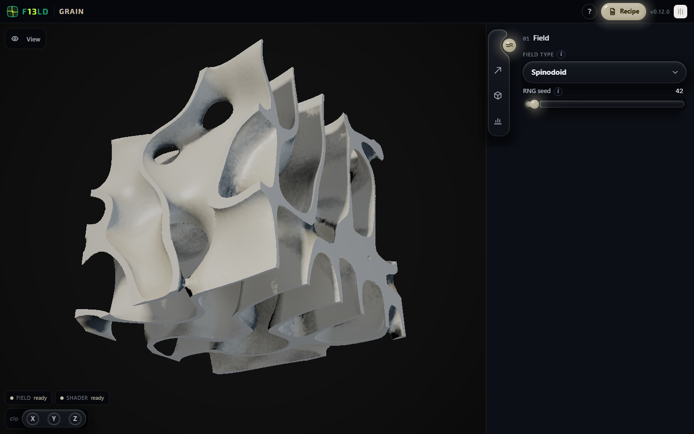

# F13LD.grain

**Part of the [F13LD](https://f13ld.app) tool suite by [Not a Robot Engineering](https://notarobot-eng.com)**

**[Open the Tool](https://mshomper.github.io/f13ld.grain)**



A browser-based implicit field explorer for generating directionally biased stochastic metamaterial scaffolds. Four mathematically distinct field types share a common design pipeline: interactive 2D section view, WebGL 2.0 raymarched 3D preview, MIL-HS mechanical homogenization, and JSON export for downstream meshing and validation.

All geometry is fully implicit — no meshes, no STL intermediates, no skeleton graphs. Structure is defined as a scalar field evaluated on demand at any point in space.

---

## Overview

Traditional periodic lattices (TPMS, BCC, FCC) offer predictable but rigid geometry. Real biological structures — trabecular bone, cartilage, insect cuticle — are stochastic: they achieve mechanical efficiency through statistical isotropy or anisotropy, not periodicity. This tool lets you explore that design space.

The four field types occupy distinct positions in the stochastic geometry landscape:

| Field type | Mechanism | Natural topology | Beam character | Directional control |
|---|---|---|---|---|
| Spinodoid | VMF wave superposition | Sheet / half-solid | Emergent at low VF + high κ | Strong — VMF concentration |
| Gaussian random field | Spectral envelope on magnitude | Sheet / half-solid | Moderate | Moderate — per-axis frequency |
| Hyperuniform kernel | Oriented Gaussian kernels on jittered grid | Half-solid | Explicit — set by aspect ratio | Good — VMF on kernel axes |
| Reaction-diffusion | Gray-Scott PDE self-organization | Sheet / half-solid | Emergent — labyrinthine | None (isotropic by physics) |

---

## Usage

Open `index.html` directly in a browser with WebGL2. One file, no build step, no dependencies.

The controls sit in four sections, one at a time: **Field**, **Direction**, **Geometry** and **Analyze**. On desktop a rail beside the panel switches them; on a phone the panel is a bottom sheet with a tab bar. Every (i) opens its help card, and the card's **show** button jumps to the control (or says why it is hidden).

**Recommended workflow:**

1. **Field** — pick a field type, then its parameters and RNG seed
2. **Direction** — single, orthotropic or isotropic bias and concentration κ (not used by reaction-diffusion, where the section is dimmed with a note)
3. **Geometry** — topology, center, half-width, flip, and the clip control to look inside
4. **Analyze** — run **homogenization** for effective mechanical properties (results clear when the design changes)
5. Hand the recipe on from the **Recipe** menu in the header: **Mesh** for watertight 3MF in [F13LD.mesh](https://mshomper.github.io/f13ld.mesh), **Lab** for the FFT solver, **Queue** to save it, or **Export JSON**

### Recipe menu

The header **Recipe** menu holds Open recipe…, Export JSON, Queue, Choose queue…, Mesh and Lab.

### Importing a recipe

**Open recipe…**, dropping a `.json` file on the page, or pasting recipe JSON outside a text field loads a grain recipe back into the tool. The header then says *Imported … · Undo*; Undo restores the previous design.

- Recipes from other F13LD tools are refused, with the tool's name.
- Values outside a control's range are clamped, with a warning. Unknown keys are ignored.
- Reaction-diffusion recipes simulate automatically after import.
- Homogenization results are not restored (run it again).

---

## Field Types

### Spinodoid (VMF wave superposition)

```
φ(x) = (1/√N) · Σᵢ cos(kᵢ · x + θᵢ)
```

Wave vectors **kᵢ** are drawn from a von Mises-Fisher distribution concentrated around your principal direction(s). This is the same class of fields produced by spinodal decomposition in materials science, and the closest mathematical analog to real trabecular bone microstructure.

At low volume fraction and high κ, the minority phase forms beam-like rods. At mid volume fraction, it forms interpenetrating sheets. The field is statistically homogeneous but not periodic — each seed produces a different valid realization of the same structural family.

**Parameters:**
- **N waves** — number of superposed cosines. More waves → more statistically converged, less sensitive to seed. 32–64 is the practical range.
- **Frequency** — spatial frequency of features. Lower = coarser structure.
- **RNG seed** — selects one realization from the statistical family. Different seeds produce different geometry with identical statistical properties.

### Gaussian Random Field (spectral)

```
φ̂(k) = √S(k) · ξ(k)    [spectral domain]
```

Wave vector **magnitudes** are drawn from a Gaussian spectral envelope centered at `k₀ = 2π·freq`, rather than being approximately uniform as in spinodoids. This creates a preferred **length scale** (consistent pore size) rather than a preferred **direction**. Directional anisotropy is introduced by making `k₀` depend on the projection of the wave direction onto your principal axes.

**Additional parameter:**
- **Bandwidth σ** — spectral width as a fraction of k₀. Low σ → near-periodic cells of consistent size. High σ → broad irregular spectrum, more organic character.

### Hyperuniform Kernel Field

```
φ(x) = Σᵢ exp(-‖Rᵢᵀ(x - xᵢ)‖²_ellipsoid) - 0.3
```

Kernel centers **xᵢ** are placed via a stratified jittered grid (hyperuniform distribution — suppressed long-range density fluctuations, no clustering, guaranteed whole-domain coverage). Each kernel gets a VMF-sampled orientation and an elongated Gaussian shape. The isosurface of the summed field produces smooth beam-like geometry whose character is directly set by the kernel shape.

**Additional parameters:**
- **Aspect ratio** — kernel length-to-width ratio. 1 = spherical blobs. 4–8 = beam-like struts. 10+ = near-cylindrical rods.
- **Kernel width** — cross-section diameter of each kernel in normalized coordinates.
- **N kernels** — number of kernel centers. More kernels → denser, more connected network.

> **3D render performance:** N > 80 may be slow to bake and render.

### Reaction-Diffusion (Gray-Scott)

```
∂u/∂t = Du·∇²u  −  u·v²  +  F·(1−u)
∂v/∂t = Dv·∇²v  +  u·v²  −  (F+k)·v
```

Two coupled scalar fields — activator *u* and inhibitor *v* — evolve through an explicit finite-difference PDE simulation on a 48³ grid. When the inhibitor diffuses faster than the activator (Dv = Du/2, fixed), the uniform steady state becomes unstable and spontaneously breaks into spatial patterns — the Turing instability.

Unlike the other three field types, reaction-diffusion is **emergent**: you set physical parameters and the pattern self-organizes. This is the same class of mathematical process that governs trabecular bone patterning during skeletal development. The simulation runs in a Web Worker on desktop (non-blocking) with a synchronous fallback on mobile.

In 3D, the Gray-Scott model reliably produces the **labyrinthine / bicontinuous phase** — an interconnected network topology that closely resembles trabecular and cancellous bone architecture. The feature scale, connectivity density, and strut character vary across a confirmed productive parameter region.

**Parameters:**
- **Feature scale (Du)** — sets the Turing wavelength. Dv = Du/2 is fixed. Lower Du → finer features; higher Du → coarser, more open structure.
- **Feed rate F** — controls pattern nucleation rate. Range 0.014–0.044.
- **Kill rate k** — controls pattern decay rate. Range 0.046–0.065.
- **Sim steps** — how long the PDE runs (1000–10000, step 500). Early steps produce immature, finely branched topology; late steps produce coarsened, equilibrated structure. Both are valid scaffold morphologies.
- **Tile factor** — repeats the simulated field in the shader (1–4×) without additional compute. Use higher tile values with fine-feature presets.
- **RNG seed** — sets the initial condition realization.

> Exploring outside the confirmed parameter region can produce surprising results — but may also produce nothing at all.

**Presets (confirmed 3D productive):**

| Preset | Du | F | k | Steps | Character |
|---|---|---|---|---|---|
| Micro | 0.08 | 0.030 | 0.057 | 5000 | Very fine, high surface area |
| Fine | 0.11 | 0.030 | 0.057 | 4000 | Small trabecular features |
| Reticulate | 0.14 | 0.030 | 0.062 | 6500 | Dense interconnected network |
| Trabecular | 0.14 | 0.030 | 0.057 | 3000 | Classic spongy bone analog |
| Lamellar | 0.15 | 0.030 | 0.057 | 4000 | Plate-strut cortical character |
| Cancellous | 0.16 | 0.029 | 0.056 | 3000 | Open marrow spaces (half-solid) |

> **Note on the 2D phase diagram:** The Pearson (1993) Gray-Scott phase diagram (spots, stripes, holes, coral) is a 2D result. In 3D, the labyrinthine/bicontinuous phase dominates across a broad parameter region. The presets above are validated specifically for 3D scaffold geometry.

---

## Directional Bias

Three modes, shared across Spinodoid, GRF, and Hyperuniform field types. Not applicable to Reaction-Diffusion, which produces isotropic patterns by physics.

**Single** — one principal direction specified by polar angle θ and azimuth φ.

**Orthotropic** — three independent VMF components along X, Y, Z with separate weight sliders.

**Isotropic** — wave vectors / kernel orientations drawn uniformly from the full sphere.

**Concentration κ** — controls directional clustering.
- κ = 0 → isotropic
- κ ≈ 4–8 → organic trabecular character
- κ ≥ 12 → strongly aligned, near-columnar

---

## Scaffold Geometry

**Topology** controls how the scalar field is converted to solid/void geometry:

| Mode | SDF expression | Character |
|---|---|---|
| Sheet | `abs(φ − center) < half-width` | Two surfaces bounding a hollow channel |
| Half-solid | `φ > center` | One solid domain with open pore network |
| Solid | `abs(φ − center) > half-width` (inverted) | Filled slab |

- **Center** — shifts the isosurface threshold. In half-solid mode this directly controls volume fraction.
- **Half-width** — slab thickness in sheet and solid modes.

The smoothing slider is gone. Exports still carry `geometry.smoothing`, fixed at its default, so older readers keep working.

---

## Render Quality

Render quality is automatic; there is no quality control. The scalar field is baked at a fixed 128³ and the raymarcher step count is a uniform, so changing a parameter never recompiles the shader.

- **While you interact** (drag a slider, orbit, zoom) the view renders at an adaptive reduced scale and is upscaled. Field sliders also show a 48³ preview bake while they move; the full 128³ bake starts when you release.
- **At rest** the view redraws once at full sharpness, in strips, so the page stays responsive. Any interaction cancels it and starts a new one.
- **Idle** costs nothing: the render loop sleeps until something changes.
- **Context loss** (GPU reset, tab pressure) is recovered in place: shaders and the field are rebuilt without a reload.

For reaction-diffusion the PDE simulation always runs at a fixed 48³ grid, and the result is shown through the same pipeline. **Sim steps** controls field topology, a separate axis from render quality.

---

## Homogenization (MIL-HS)

Estimates effective elastic properties from the voxelized scalar field using the Mean Intercept Length method coupled to the Hashin-Shtrikman upper bound.

**Outputs:**
- **Volume fraction ρ** — solid phase fraction
- **Ex, Ey, Ez** — directional Young's moduli (GPa)
- **Gxy** — shear modulus (GPa)
- **νeff** — effective Poisson's ratio
- **Zener A** — anisotropy ratio. A = 1 is perfectly isotropic.
- **Stiffness ellipsoid** — rotating WebGL visualization of the directional stiffness surface

**E_s (GPa)** — solid material stiffness. Ti6Al4V ≈ 114 GPa, PEEK ≈ 3.6 GPa, 316L stainless ≈ 193 GPa.

> MIL-HS assumes statistical homogeneity. Results improve with higher grid resolution and higher N waves / N kernels. Reaction-diffusion fields are statistically isotropic — homogenization will reflect this.

---

## Export JSON

The exported JSON carries the complete parameter set and, if homogenization has been run for the current design, the mechanical results (they are dropped once the design changes). This file is the handoff to [F13LD.mesh](https://mshomper.github.io/f13ld.mesh) and [F13LD.lab](https://mshomper.github.io/f13ld.lab).

Changes in v0.12.0:
- `field.hu_lock_scale` is new. It records the "lock feature scale" switch: with it on, `hu_width` is the effective width (scaled by the cube root of 30/N) and the import undoes that scaling. F13LD.mesh and F13LD.lab ignore the key.
- `geometry.smoothing` is kept at its default; the slider was removed. A non-zero value in an imported recipe is ignored with a warning.
- `meta.version` is now `0.12.0` (it had stayed at `0.9.4`).

**Wave-based fields (spinodoid / GRF / hyperuniform):**
```json
{
  "meta": { "version": "0.12.0", "tool": "grain", "timestamp": "..." },
  "field": {
    "type": "spinodoid | gaussian | hyperuniform",
    "n_waves": 48,
    "kappa": 6.0,
    "frequency": 0.45,
    "rng_seed": 42,
    "dir_mode": "single | ortho | iso",
    "principal_direction": [0, 0, 1],
    "ortho_weights": null,
    "hu_lock_scale": false
  },
  "geometry": {
    "center": 0.0,
    "half_width": 0.15,
    "smoothing": 0.0,
    "topology": "sheet | half | solid"
  }
}
```

**Reaction-diffusion:**
```json
{
  "meta": { "version": "0.12.0", "tool": "grain", "timestamp": "..." },
  "field": {
    "type": "reactiondiffusion",
    "rd_Du": 0.14,
    "rd_F": 0.030,
    "rd_k": 0.057,
    "rd_tile": 2,
    "rd_steps": 3000,
    "rng_seed": 42
  },
  "geometry": {
    "center": 0.5,
    "half_width": 0.10,
    "topology": "sheet"
  }
}
```

---

## Part of the F13LD Suite

The full tool list, what each one does and how recipes move between them: **[f13ld.app](https://f13ld.app)**.

---

## Technical Notes

**Fully implicit** — all geometry is defined as a scalar field evaluated pointwise. No mesh generation or STL intermediates exist until Manifold levelSet is invoked in F13LD.mesh.

**3D view** — WebGL 2.0 raymarcher over a baked 3D texture. The field is baked in a worker (main-thread fallback) at a fixed 128³, with a 48³ preview while a field slider moves. Step count and threshold are uniforms, so the shader compiles once and never recompiles on a parameter change. Reaction-diffusion bakes its 48³ PDE result into the same texture.

**Reaction-diffusion rendering** — tiling is applied in the fragment shader via `fract()`, with no additional compute cost.

**Controls** — the panel uses [liquid-ui](https://github.com/mshomper/liquid-ui) widgets (sliders, dropdowns, segmented controls, toggles, Recipe menu), drawn in WebGL over the native inputs, which stay the source of state. Without WebGL the native controls are shown instead.

**Web Worker** — reaction-diffusion PDE integration runs in a background Worker on desktop, keeping the UI responsive during simulation. A synchronous fallback is used on mobile platforms where Workers are unavailable; a `· mobile` badge appears over the viewer.

**Browser compatibility** — Chrome and Firefox. WebGL 2.0 required.

---

## References

- Turing, A.M. (1952). The chemical basis of morphogenesis. *Phil. Trans. R. Soc. B*, 237, 37–72.
- Gray, P. & Scott, S.K. (1985). Sustained oscillations and other exotic patterns. *J. Phys. Chem.*, 89(1), 22–32.
- Pearson, J.E. (1993). Complex patterns in a simple system. *Science*, 261, 189–192.
- Kumar, S. et al. (2020). Inverse-designed spinodoid metamaterials. *npj Computational Materials*, 6, 73.

---

## License

MIT — see LICENSE file.

*Not a Robot Engineering · notarobot-eng.com*
